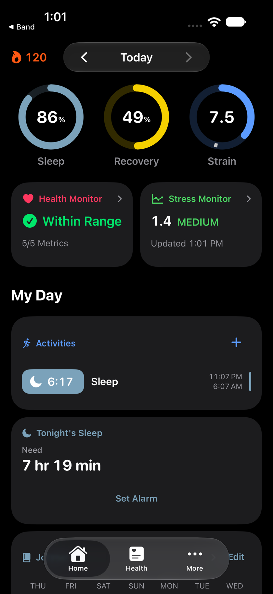
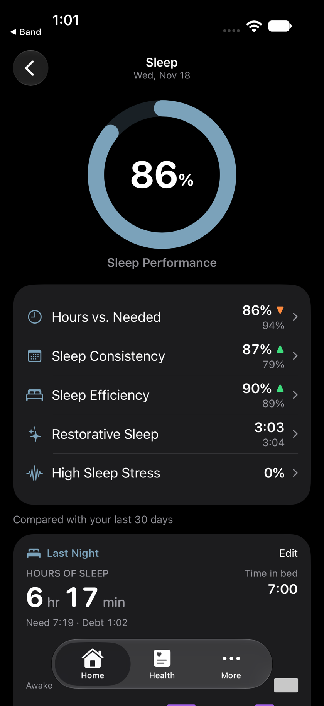
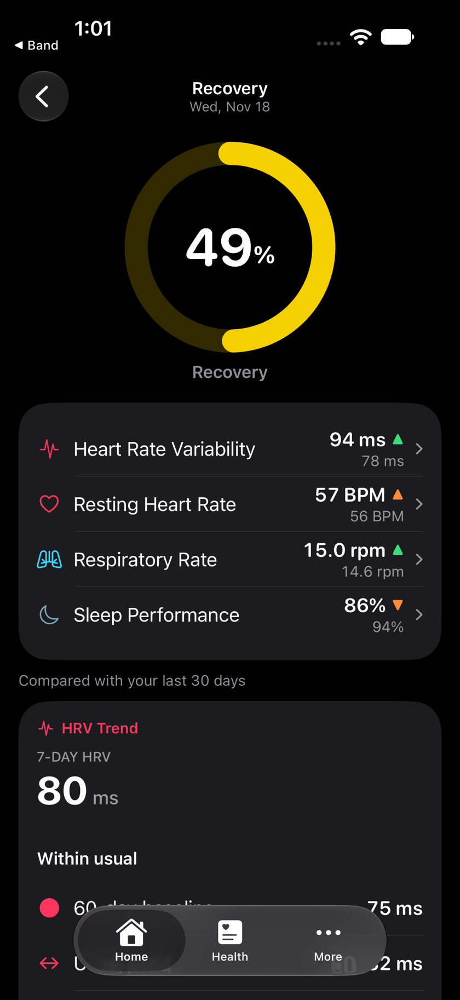
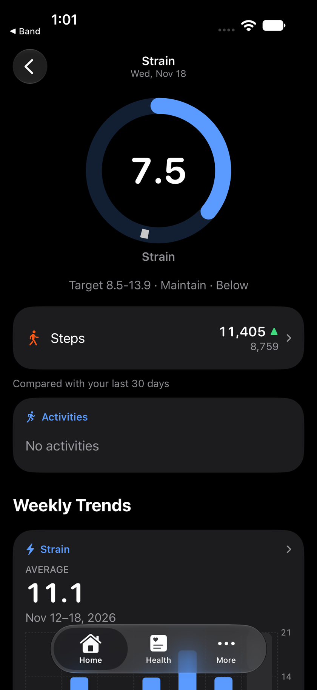
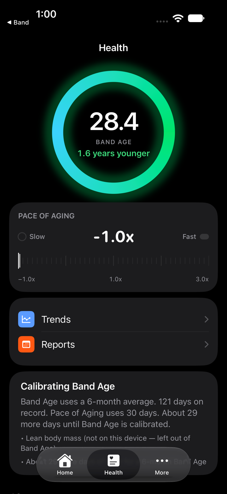
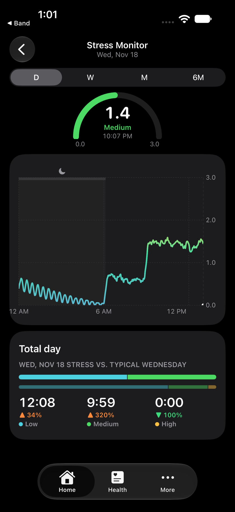

# Band

Band is a personal, offline iPhone companion for the WHOOP 5.0 strap. It pairs over Bluetooth,
keeps every reading in an on-device SQLite store, and computes sleep, recovery, strain, stress and
the rest locally. There is no account, no server and no telemetry.

The aim is WHOOP's experience, built the Apple way: the same scores and screens, using WHOOP's
published methods where they exist, checked against a real WHOOP export.

Band is a fork of [NOOP](https://github.com/ryanbr/noop) and is not affiliated with WHOOP.

Screenshots below are from a DEBUG Simulator build seeded with **synthetic**
`AppleDemoSeeder` data. They are not anyone's personal health data.

<table>
  <tr>
    <td align="center" width="33%"><br><sub>Home — rings, Health / Stress, My Day</sub></td>
    <td align="center" width="33%"><br><sub>Sleep — consistency, last night, Sleep Stress</sub></td>
    <td align="center" width="33%"><br><sub>Recovery</sub></td>
  </tr>
  <tr>
    <td align="center"><br><sub>Strain</sub></td>
    <td align="center"><br><sub>Healthspan — Band Age &amp; Pace of Aging</sub></td>
    <td align="center"><br><sub>Stress Monitor</sub></td>
  </tr>
</table>

## What it does

- **Scores:**
  - Sleep, Recovery and Strain rings, with a personal strain target.
  - Stress Monitor (0–3, per minute).
  - Health Monitor: typical ranges for RHR, HRV, respiratory rate, SpO₂ and skin temperature.
- **Sleep:**
  - A learned four-stage sleep stager.
  - Sleep need, sleep debt and consistency.
  - A Sleep Planner with a bedtime recommendation, tied to the strap alarm.
- **Activities:**
  - Automatic workout detection.
  - WHOOP heart-rate-reserve zones.
  - Muscular load for logged strength sets.
  - Recovery activities (sauna, cold plunge and similar).
  - Steps per workout.
  - Apple Health import and write-back, so workouts can reach Strava through Health.
- **Insights:**
  - Healthspan: Band Age and Pace of Aging.
  - Weekly and monthly assessments.
  - A 100-behaviour journal, with an impact ranking for each behaviour.
  - HRV trend.
  - A two-night illness signal.
- **Notifications:** Recovery is ready, Health Monitor out of range, sleep recorded, and strap
  battery (low at 20%, full).

## Installation

### Requirements

- A Mac with **Xcode** (the **iOS 26 SDK**).
- [XcodeGen](https://github.com/yonaskolb/XcodeGen): `brew install xcodegen`.
- A physical **iPhone** (iOS 17+; **iOS 18+ / 26** recommended for zoom continuity and Liquid Glass).
  BLE to a strap does not work in the Simulator.
- A **WHOOP 5.0** strap, already set up at least once so it has firmware and a bond.

`project.yml` is the source of truth. The Xcode project is generated and never committed.

### Important: Bluetooth / strap sync

The WHOOP 5.0 strap keeps history in a **single shared circular flash buffer**. When a client
acknowledges records, the strap advances the read pointer and **trims** those records off the
device.

If the official WHOOP app is running in the background on the same phone, iOS will wake it over
BLE. WHOOP then pulls new samples and trims them before Band syncs. The usual symptom is **missing
morning or daytime heart-rate gaps**.

On the phone you pair with Band:

1. Force-quit the official WHOOP app, **or**
2. Revoke its Bluetooth permission, **or**
3. Unpair the strap from the official app after the initial strap setup.

Band needs exclusive (or at least first) access to the buffer. A spare phone with Band only is the
cleanest setup.

### Step 1 — Clone and configure signing

```bash
git clone https://github.com/jasonjche/noop.git
cd noop
cp Config/BundleIdSecrets.example.xcconfig Config/BundleIdSecrets.xcconfig
```

`Config/BundleIdSecrets.xcconfig` is gitignored. Edit it:

```
BUNDLE_ID_PREFIX = com.yourdomain
DEVELOPMENT_TEAM = ABCDE12345
NOOP_PERSONAL_BUILD = YES
```

| Key | What it does |
|---|---|
| `BUNDLE_ID_PREFIX` | Reverse-DNS prefix for the app, widgets, watch companion and App Group. Avoids colliding with another Band / NOOP install. |
| `DEVELOPMENT_TEAM` | Your Apple Team ID ([Membership details](https://developer.apple.com/account)). Stops Xcode asking you to re-pick a team after every `xcodegen generate`. |
| `NOOP_PERSONAL_BUILD = YES` | Skips first-run onboarding / terms / What's New and upstream update nags. |

A **free Apple ID** signs for 7 days (then re-run from Xcode). A **paid Apple Developer** account
signs for a year. Find the Team ID under Membership details; leave `DEVELOPMENT_TEAM` blank only if
you will pick the team in Xcode by hand.

### Step 2 — Generate and install

```bash
xcodegen generate
```

**Xcode (GUI).** Open `Band.xcodeproj`, select the **Band** scheme and your iPhone, then Run.

**Command line (USB or Wi-Fi).** List devices, build Release, install, launch:

```bash
xcrun devicectl list devices

# Replace DEVICE_ID with the UDID from the list.
xcodebuild \
  -project Band.xcodeproj \
  -scheme Band \
  -configuration Release \
  -destination 'id=DEVICE_ID' \
  -derivedDataPath build \
  -allowProvisioningUpdates \
  build

APP="build/Build/Products/Release-iphoneos/Band.app"
xcrun devicectl device install app --device DEVICE_ID "$APP"
xcrun devicectl device process launch --device DEVICE_ID com.yourdomain.noop
```

Wi-Fi installs use the same `devicectl` commands once the phone has been paired over USB at least
once and Developer Mode is on.

**First launch.** On the iPhone: **Settings → General → VPN & Device Management → Trust** your
Apple ID. Until you trust the profile, iOS refuses to run the app.

### Step 3 — Seed history (optional)

On day one the 30-day / 90-day personal baselines (HRV, RHR, Sleep Need, Healthspan, Journal Impact)
are still warming up. Importing a WHOOP data export calibrates them immediately.

1. From the WHOOP app / account, download your data export (`.zip` or a folder of CSVs).
2. In Band: **More → Data & Backup → Import WHOOP Export**.
3. Optionally enable **Apple Health** on the same screen (two-way: workouts and vitals in, Band
   scores and workouts out).
4. Optionally enable **Backup** / iCloud Drive automatic backup so the on-device SQLite is copied
   off the phone.

The importer is streaming and memory-bounded. A full-account export is the right input; it is how
Band learns your history without waiting months on the strap.

## Layout

| Path | Contents |
|---|---|
| `Packages/WhoopProtocol` | BLE frame parsing, CRC, command and event decoding. Pure Swift, no CoreBluetooth. |
| `Packages/WhoopStore` | GRDB / SQLite persistence and migrations. |
| `Packages/StrandAnalytics` | All scoring maths: HRV, recovery, strain, sleep, stress, calories and more. Database-free. |
| `Packages/StrandImport` | WHOOP CSV and Apple Health importers. |
| `Packages/StrandDesign` | Design tokens and shared SwiftUI components. |
| `Strand/` | App code: BLE, collection, repository, and the native UI in `Strand/Native`. |
| `StrandiOS/` | The iOS app entry point and tab shell. |
| `Tools/BandCheck` | Replay harness that scores Band against a WHOOP export and fails on regressions. |
| `Tools/SleepPSG`, `Tools/SleepBench` | Sleep-staging benchmarks against public sleep-lab data and on-device references. |

## Research & methodologies

Scoring lives in `Packages/StrandAnalytics` (`BandScores`, `BandStrain`, `HRVAnalyzer`,
`SleepStagerV2` / `SleepStageLearned`, `HealthspanEngine`, `JournalImpact`). A change is an
improvement only when a pre-registered, regenerable harness says so. The rules are in
[`docs/VALIDATION_PROTOCOL.md`](docs/VALIDATION_PROTOCOL.md).

### 1. Empirical validation protocol

[`docs/VALIDATION_PROTOCOL.md`](docs/VALIDATION_PROTOCOL.md) is prescriptive. The failures it
prevents are process failures, not arithmetic ones.

- **Pre-register the domain.** Whole-record sleep/wake κ and in-session κ are different questions.
  On one window they moved 0.70 (0.795 vs 0.095) with the same nights, same reference, same
  predictor. SleepBench section C is in-session; it is not comparable to a whole-record figure.
  Write the domain down before you measure.
- **No self-comparison.** A lightly edited hypnogram is mostly the stager talking to itself.
  `Tools/SleepBench` prints `E.-1 SELF-COMPARISON AUDIT` and a ready-to-paste `--exclude` list for
  the database you are about to use. Take that list. If fewer than 5 nights survive, the result is
  “cannot be measured”, not a number with a caveat.
- **Re-derive; never cite.** Every figure ships with the command that regenerates it.
  `Tools/BandCheck`, `Tools/SleepPSG` and `Tools/SleepBench` are those commands.
- **Hold out a temporal split.** Wearable failure modes are temporal (firmware, season, a new
  strap). Random splits leak. The fitted `BandScores` parameters in
  `Packages/StrandAnalytics/.../BandScores/Resources/params.json` were trained on the first 318 of
  455 days (~70%) and gated on the later 30%. `Tools/BandCheck/thresholds.json` is the held-out
  contract: **no algorithm change ships unless held-out MAE, bias and within-tolerance agreement
  improve.**

```bash
swift run --package-path Tools/BandCheck bandcheck \
  --db <copy of whoop.sqlite> --export <WHOOP export dir> --labels <labels.json>
```

The database is opened `immutable=1`. Thresholds live in `Tools/BandCheck/thresholds.json`.
`swift test --package-path Tools/BandCheck` is the unit suite and uses no health data.

Sleep staging against human-scored polysomnography:

```bash
cd Tools/SleepPSG
swift run -c release sleeppsg --dataset ~/datasets/motion-and-heart-rate-*-1.0.0
```

That replays shipped `SleepStagerV2` epoch-for-epoch against PhysioNet `sleep-accel` (Walch et al.,
SLEEP 2019). The dataset stays outside the repo.

### 2. Causal daily scoring pipeline (`BandScores`)

`BandScores.evaluate` is strictly causal: tonight's scores see only prior cycles.

**Load Index (`BandLoadIndex`).** A portable physiological-cycle load:

```
strain_hat = intercept
           + c_energy  · log1p(energy_kcal)
           + c_edwards · log1p(Edwards TRIMP)
           + c_z45     · Zone 4–5 minutes
```

Edwards TRIMP is `duration_min × (1·z1 + 2·z2 + 3·z3 + 4·z4 + 5·z5) / 100` from workout zone
percents. The cycle is sleep-to-sleep, so tonight's Sleep Need uses **yesterday's** `strain_hat`.

**Recursive Sleep Debt ledger (`BandSleepLedger`).** A decaying debt state `d`:

```
d_t     = clip(decay · d_{t-1} + gain · shortfall − credit · extra + bias)
need_t  = clip(base + a · load_{t-1} + b · d_t − k_nap · nap_{t-1})
```

Lagged prior-cycle load, decaying multi-night debt, and nap credit set tonight's Sleep Need.
Need is clipped to a fitted `[needLo, needHi]` band.

**Sleep Regularity / Consistency (`BandConsistency`).** Each night is a 1,440-minute bit-packed
sleep/wake mask (onset/wake plus naps). Over a **5-night** window, last-vs-each overlap is the
Sleep Regularity Index, recency-weighted `0.7^age`, then affine-mapped onto **0–100%**. Nights with
under 60 occupied minutes are skipped as too thin.

**Sleep Performance (`BandSleepPerformance`).** A non-linear hours-vs-needed power curve, plus
Consistency, plus in-bed Efficiency:

```
HVN     = 100 · asleep / max(need, 200 min)
HVN'    = 100 · (clip(HVN) / 100) ^ hvn_power
perf    = clip(intercept + w_hvn · HVN' + w_cons · consistency + w_eff · 100 · asleep / inbed)
```

**Adaptive baselines & source-switch Kalman (`BandBaselines`).** Resting HRV (`hrv_ln`), RHR,
respiratory rate, skin temperature and median SpO₂ each have a **prior-only** winsorized EWMA
(outlier hold-out, MAD z-scale, clip ±6). When the overnight source switches from `imported` →
`strap`, HRV splices onto a local-level Kalman filter with **one-shot covariance inflation**
(`P += inflate · Var_old`, bundled `inflate = 16`). Historical exports warm-start live strap
scoring without a step-change in Recovery.

**Recovery (`BandRecovery` / `BandRecoveryV3`).** The shipped head (`BandRecoveryV3`) is a logistic
of a **millisecond EWMA of HRV** (not ln) plus Sleep Performance, with a hinge sleep-sufficiency
penalty `max(0, hingeHvn − asleep/need)` that is zero on long nights. Source changes restart the
EWMA and withhold Recovery until `warmupNights` finite-z observations on the new source. The
fallback (`BandRecovery`) is a multi-vital z-score composite (HRV, RHR, RR, temperature, SpO₂,
sleep) through the same logistic.

### 3. Heart-rate reserve day & workout Strain (`BandStrain`)

Continuous **1 Hz** samples are weighted by Karvonen **%HRR** below 50% HRmax (sedentary, sleep at
or below resting HR contributes 0) and by soft-capped **%HRmax** zones above that (`hr / maxHR`
capped at 1.5). Per-minute load `L` maps onto the **0–21** scale:

```
strain = maxStrain · (1 − exp(−k · L^p))
```

Day strain is the map over the calendar day's strap HR, never a sum of activity strains. When a
logged workout's window has under 50% strap-HR coverage (Apple Watch off-strap is the usual case),
that workout's load is **backfilled** into `L_day` and the 0–21 map saturates; day strain is then at
least the day's highest activity strain. Overlapping Apple-import and strap copies of the same
session are collapsed so load is not counted twice.

The `eval.strain_c_heldout` gate in `thresholds.json` is the 70/30 held-out contract for this map.
Storage elsewhere keeps Effort 0–100 = strain21 × 100/21.

### 4. R-R interval cleaning & overnight HRV (`HRVAnalyzer`)

[`docs/RR-OPTIMIZATION.md`](docs/RR-OPTIMIZATION.md) is the measurement record.

Cleaning is range `[300, 2000] ms` plus a Malik 20% local-median ectopic filter. Plain successive
differences then have a defect: a dropped beat splices its neighbours, and RMSSD **squares** that
inflated delta. **`cleanRRGapAware` / `rmssdGapAware`** skip any difference that straddles a dropped
beat. On clean data the two paths are identical.

On real optical PPG this cut whole-night HRV MAE versus WHOOP from 8.47 ms to 5.47 ms (**35%**).
Sequence-keyed storage `(deviceId, ts, rrMs, seq)` stops two equal same-second intervals colliding
under `INSERT IGNORE` and being dropped — the same class of bias, on the write path.

Empirical testing **refuted** stage-based SWS windowing as a way to match WHOOP's lower HRV: deep
sleep has the *highest* HRV on these nights, so a deep window reads higher, not lower. Overnight
HRV is gated on artifact/coverage quality (`rrCoverage`, `beatAccurateFraction`) instead. A
variance / stillest-window selector is a live idea; a stage selector is not.

### 5. Cardiorespiratory sleep staging (`SleepStageLearned` / `SleepStagerV2`)

Default staging is `SleepStagerV2`: **30-second** epochs from tri-axial gravity/motion, HR, R-R
autonomic features, and respiratory sinus arrhythmia (RSA recovered from the R-R stream). A
per-night deep gate, a soft sleep-cycle prior, a peak-motion wake gate relative to the night's own
quiescent floor, and Viterbi/HMM smoothing. Coefficients are fixed a priori.

`SleepStageLearned` is the boosted-tree hypnogram (ported from reNOOP) evaluated in pure Swift from
tree-as-text resources. It stages inside an already-detected in-bed window; thin motion or HR
coverage returns nil and the caller falls back to the recipe. Both are benchmarked
epoch-for-epoch against human-scored PhysioNet PSG in `Tools/SleepPSG`.

### 6. Baseline-relative Stress Monitor (`BandStress`)

A 0–3 score at **1-minute** grain: HR, and optional RMSSD, versus the wearer's own overnight RHR /
HRV baselines (day's values, else a 30-night median, else 60 bpm / HR-only). Sitting near RHR reads
Low; +24 bpm is High.

Buckets are omitted — not scored Low — when:

- a logged workout overlaps the minute,
- a **post-workout recovery shadow** is still running (HR not yet within 15 bpm of the pre-workout
  mean, intensity-scaled cap 15–60 minutes),
- step-class (walk/run share ≥ 0.15) or gravity motion (≥ 0.20 g on ≥ 30% of samples) marks the
  minute as activity.

The series is then a **centred 5-minute** smooth (`smoothWindowSeconds = 300`). Overnight High-share
on Sleep uses the same 5-minute window. There is no WHOOP stress series to fit; this is Band's
estimator.

### 7. Healthspan (Band Age & Pace of Aging) and Journal Impact

**Band Age / Pace of Aging (`HealthspanEngine`).** Independent of WHOOP's closed model; same method
family as patent WO2026161891A1. Each wearable metric maps to a published all-cause-mortality
hazard ratio versus a health-optimized referent; years = `ln(HR) / 0.1`. Contributors (sleep,
strain/activity, fitness: steps, RHR, VO₂max, strength, optional lean mass) are summed. **Band
Age** is a 6-month average (~150 nights to calibrate); **Pace of Aging** is the 30-day window
projected over six months (ready around 21 recoveries). HRV is excluded. Held-out labels gate
calibration through BandCheck section F (`healthspan_calibration.max_abs_total_years`).

This is a wellness comparison, not a biological or clinical age.

**Fitness Age (`FitnessAgeEngine`).** A separate claim: Nes 2011 / HUNT3 non-exercise VO₂max
(waist-circumference variant; JAHA / Ball State 2020 reproduction) with a reconstructed PA-index
from measured training instead of the HUNT1 questionnaire. Headline Fitness Age is a
**self-consistent inversion** of the same equation at a population-reference body, so the waist
term cancels and no body measurement is required. Weekly, Saturday-stamped, 7-day medians, ≥4-of-7
nights of RHR, shown in a ±5-year band. See [`docs/FITNESS_AGE.md`](docs/FITNESS_AGE.md).

**Journal Impact (`JournalImpact`).** For each yes/no behaviour, `mean(outcome | yes) − mean(outcome | no)`
on wake-day **D** (the same key as that morning's Recovery). Unlogged days are **dropped**, not
treated as “No”. A behaviour appears only with ≥ 5 yes and 5 no days that also have an outcome.
Uncertainty is a **Welch 90%** interval; Helps / Hurts only when that interval excludes zero.
Preferred lookback is 90 days, falling back to all history when the window is thin. Associations
in the wearer's own days. Not a cause.

### 8. Clean-room BLE interoperability and hardware safety

Inbound frames are rejected unless the **full** integrity verdict is true: header checksum, payload
**CRC32**, and structural size. `WhoopProtocol.HistoricalStreamDecoder` is a fused single-pass
WHOOP 5.0 historical packet decoder (type-47 versions mapped in one walk; anything else falls back
to `parseFrame` so output stays byte-identical).

Outbound traffic is a **strictly reversible allowlist** (`Strand/BLE/Commands.swift`,
`WhoopCommand`). Band never sends firmware / DFU, force-trim, ship-mode, power-cycle,
fuel-gauge reset, or anything whose effect cannot be shown to reverse. `rebootStrap` is the narrow
exception: a restart that keeps stored data, confirmation-gated, never sent automatically. See
[`AGENTS.md`](AGENTS.md) and [`docs/SAFEGUARDS.md`](docs/SAFEGUARDS.md).

## Checking the numbers

`BandCheck` replays Band's algorithms over a WHOOP CSV export and a copy of the phone's database.
It reports agreement per score and checks invariants. It exits non-zero if a change makes any
gated score worse. Details are in [Research & methodologies](#research--methodologies) above.

## Strap safety

Band only sends the strap commands NOOP already curated, and every one of them can be undone. It
never sends firmware, ship-mode, factory-reset or other destructive commands. See `AGENTS.md`.

## Licence and credits

Band is a fork of NOOP and keeps NOOP's licence: [PolyForm Noncommercial 1.0.0](LICENSE).
Third-party components and ported work, including the learned sleep stager from
[reNOOP](https://github.com/denismanulov/reNOOP), are credited in [NOTICE](NOTICE) and
[ATTRIBUTION.md](ATTRIBUTION.md).

WHOOP is a trademark of WHOOP, Inc. Band is an independent, clean-room interoperability project
for hardware you own. It contains no WHOOP firmware, app code or assets. Band is not a medical
device; see [DISCLAIMER.md](DISCLAIMER.md).
